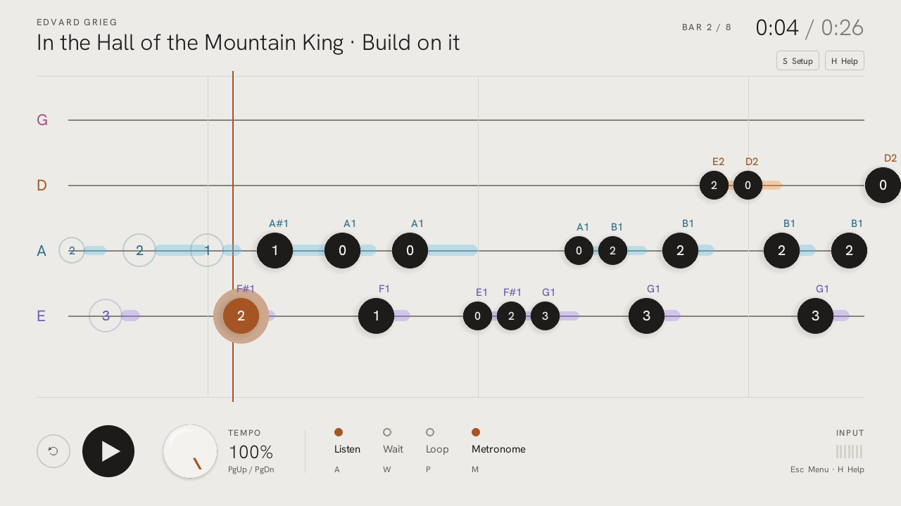

# PickHero

**Üben mit dem echten Instrument.** PickHero lässt die Tabulatur laufen, hört
über dein Mikrofon oder Audio-Interface zu und zeigt dir, welche Töne du
gefunden hast und ob sie im Takt waren — getrennt voneinander, weil es zwei
verschiedene Fähigkeiten sind.

Kostenlos, offline, für Windows. [English](README.md)



## Was es kann

- **Hört dein Spiel** in Echtzeit und markiert jeden Ton als gefunden, knapp oder verfehlt.
- **Timing für sich:** ein zu früh gespielter Ton zählt trotzdem als gefunden; das Timing steht daneben, es wird nicht abgezogen.
- **Gitarre, Bass-Gitarre und Bass-Ukulele**, dazu jede Stimmung, die eine Tab-Datei mitbringt.
- **Ein Lernpfad** aus zehn kurzen Lektionen und acht Stücke zum Spielen — darunter
  *Ode an die Freude*, *When the Saints Go Marching In* und *In der Halle des Bergkönigs* —
  jeweils in einer leichten und einer ausgebauten Fassung.
- **Eigene Tabs:** Guitar Pro 3, 4, 5, 7 und 8 sowie MIDI, mit Hörprobe vor dem Spielen.
- **Übungshilfen:** bis auf 25 % verlangsamen, Abschnitte wiederholen, auf den richtigen Ton warten,
  Metronom und Einzähler.
- **Ein Einrichtungs-Leitfaden** beim ersten Start: Mikrofon, Pegel, Stimmung.
- **Drei Looks** — Studio, Stage, Hi-fi — auf Deutsch oder Englisch.

## Privat von Grund auf

Kein Konto, kein Netzwerkzugriff, keine Telemetrie. Tabs, Fortschritt und
Übungsaufnahmen bleiben auf deinem Rechner. Fremde Dateien werden in einem
eigenen, eingeschränkten Prozess gelesen.

## Loslegen

Ein fertiger Windows-Download ist in Vorbereitung. Bis dahin startest du
PickHero aus dem Quellcode (Windows, Python 3.12, [uv](https://docs.astral.sh/uv/)):

```powershell
powershell -NoProfile -ExecutionPolicy Bypass -File scripts/setup.ps1
.\START.bat
```

Du brauchst einen Eingang: ein USB-Mikrofon oder ein Instrumentenkabel in ein
Audio-Interface.

## Herkunft und Lizenz

PickHero wurde von [Artem Shamsuarov](https://github.com/Artemarius/PickHero)
begonnen. Diese Version führt es fort.

Der Code steht unter der MIT-Lizenz — siehe [LICENSE](LICENSE). Der
Windows-Build enthält Fremdkomponenten unter eigenen Lizenzen, darunter aubio
(GPL-3.0, Quellcode liegt bei) und die Schriften (SIL Open Font License); alle
Hinweise stehen in [licenses/](licenses/).
