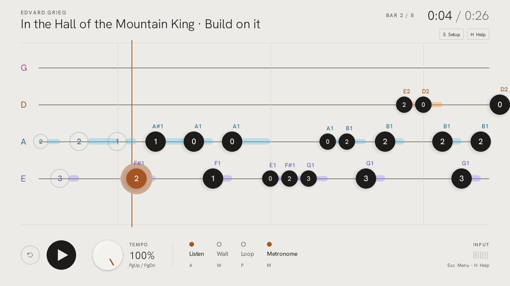
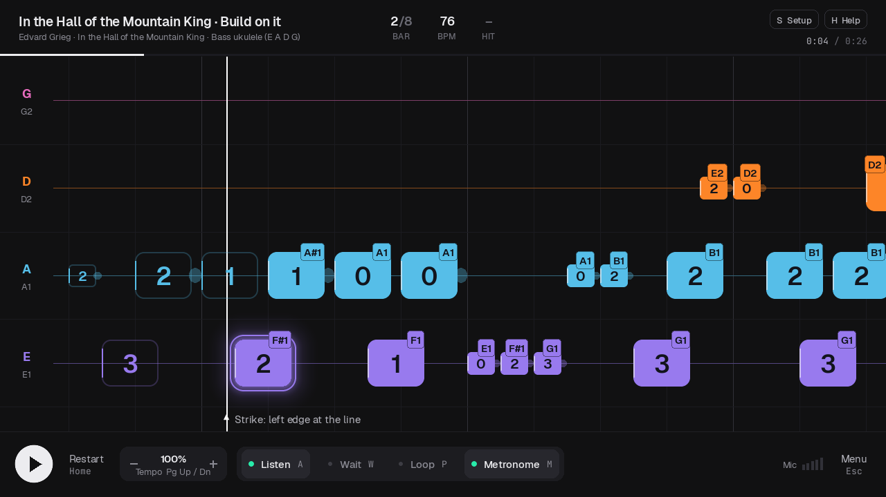
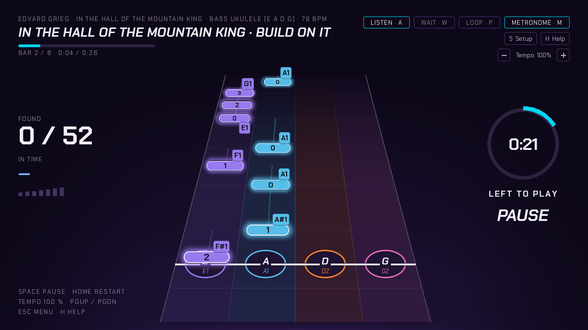
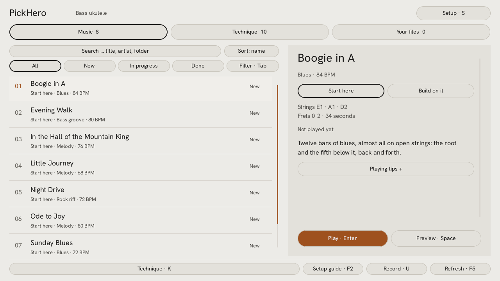

# PickHero

**Practise with your real instrument.** PickHero scrolls the tab, listens through
your microphone or audio interface, and tells you which notes you found and
whether they were on time — as two separate things, because they are two
separate skills.

Free, offline, for Windows. [Deutsch](README.de.md)



## What it does

- **Hears your playing** in real time and marks each note as found, close or missed.
- **Timing on its own:** a note played early still counts as found; timing is shown beside it, not taken off it.
- **Guitar, bass guitar and bass ukulele**, plus any tuning a tab file brings along.
- **A learning path** of ten short lessons, and eight pieces to play — among them
  *Ode to Joy*, *When the Saints Go Marching In* and *In the Hall of the Mountain King* —
  each in an easy and a fuller version.
- **Your own tabs:** Guitar Pro 3, 4, 5, 7 and 8, and MIDI files, with a preview before you play.
- **Practice tools:** slow down to 25 %, loop a section, wait for the right note,
  metronome and count-in.
- **A setup guide** on first start: microphone, input level, tuning check.
- **Three looks** — Studio, Stage, Hi-fi — and English or German.

<p>
  
  
  
</p>

## Private by design

No account, no network access, no telemetry. Tabs, progress and any practice
recordings stay on your computer. Files from elsewhere are read in a separate,
restricted process.

## Get started

A ready-made download is being prepared. Until then, three steps on Windows
10 or 11 — no Python needed, PickHero brings its own:

1. **Install uv** once. Open PowerShell (Start menu, type *PowerShell*) and paste:
   ```powershell
   powershell -ExecutionPolicy ByPass -c "irm https://astral.sh/uv/install.ps1 | iex"
   ```
   Already have uv? Update it with `uv self update`.
2. **Get PickHero:** green **Code** button at the top of this page →
   **Download ZIP**. Right-click the ZIP file → **Extract All**.
3. **Double-click `START.bat`** in the unzipped folder. The first start
   sets everything up, which takes a few minutes and needs the internet once.
   After that it starts straight away. If Windows says it protected your PC:
   PickHero is not signed — click **More info**, then **Run anyway**.

Plug in a USB microphone, or an instrument cable into an audio interface.
On first start a short guide helps you pick it and set the level.

## Development

```powershell
.venv\Scripts\python.exe -m pytest
.\build.bat
```

Tests run without audio hardware and never touch your own settings.
`build.bat` creates `dist/PickHero.exe` and checks the package.

## Credits and licence

PickHero was started by [Artem Shamsuarov](https://github.com/Artemarius/PickHero).
This version continues it.

The code is MIT-licensed — see [LICENSE](LICENSE). The Windows build bundles
third-party components under their own licences, among them aubio (GPL-3.0,
source included) and the fonts (SIL Open Font License); all notices are in
[licenses/](licenses/).
